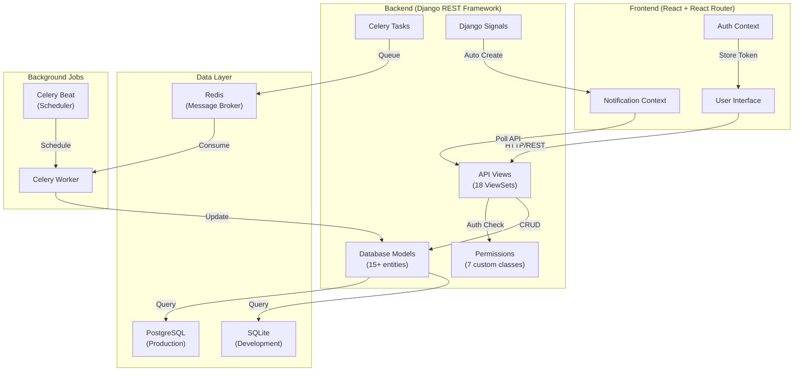

# 🎬 Movie Theater Booking System

A **full-stack web application** for browsing movies, selecting showtimes, choosing seats, and making bookings. The system integrates **Django REST Framework** on the backend with a **React frontend**, and stores data in **PostgreSQL**. It provides a modern, mobile-friendly interface and is designed to simulate a realistic theater booking flow.

🌐 **Live Demo:**  
- Frontend → [Netlify Deployment](https://dali-movie-theater.netlify.app)  
- Backend API → [Render Deployment](https://movie-theater-dots.onrender.com)  
- Demo Video → [YouTube Walkthrough](https://www.youtube.com/watch?v=YrqwYAZTVQ8)

---

## 🛠️ Distinctiveness and Complexity

This project is **fundamentally distinct** from other CS50W assignments in both concept and implementation complexity.

### **Why This Is NOT a Social Network (Unlike Project 4)**

Project 4 focused on user-to-user interactions: following users, posting content, liking posts, and viewing other users' activities. My movie theater system operates on an entirely different paradigm—**business-to-consumer service booking**. Users interact with a centralized inventory system (showtimes and seats) rather than with each other. There are no user profiles to view, no following mechanisms, no feeds of user activities, and no social interactions. The core functionality revolves around **resource reservation** (seats) and **scheduling** (showtimes), which are fundamentally different from social networking concepts.

### **Why This Is NOT E-Commerce (Unlike Project 2)**

While Project 2 involved product listings and bidding, my system doesn't use a shopping cart model or product inventory management. Instead, it implements **real-time seat reservation** with time-sensitive booking windows, which is closer to airline or concert ticket systems than traditional e-commerce. The key differences include:

- **Inventory Scarcity**: Seats are unique, non-replenishable resources tied to specific time slots
- **Temporal Constraints**: Bookings become invalid after showtime, unlike products that remain available
- **Concurrency Management**: Multiple users can compete for the same seat simultaneously, requiring atomic database operations
- **Status Workflows**: Bookings progress through Pending → Confirmed → Attended states with automated transitions

### **Technical Complexity Beyond Previous Projects**

This project required solving engineering challenges not present in earlier assignments:

**1. Real-Time Concurrency Management**
- Implemented atomic seat booking with Django's `F()` expressions to prevent race conditions
- Server-side validation ensures no double-booking even under high concurrent load
- Database-level constraints maintain data integrity across simultaneous booking attempts

**2. Asynchronous Task Processing**
- Celery background tasks handle business-critical workflows: payment deadline enforcement, showtime reminders, and automatic seat release
- Redis message broker enables distributed task processing
- Implemented retry mechanisms with exponential backoff for failed notifications

**3. Complex State Management**
- Frontend React context manages authentication, notifications, and real-time seat availability
- Backend implements sophisticated booking lifecycle management with multiple status transitions
- Cross-cutting concerns like user points, watchlists, and notifications require careful state synchronization

**4. Production-Grade Architecture**
- Dockerized multi-service deployment with PostgreSQL, Redis, and Celery workers
- CI/CD pipeline with automated testing, linting, and deployment
- Environment-specific configuration management for development and production

**5. Advanced API Design**
- RESTful endpoints with custom actions for complex business operations (seat selection, booking confirmation)
- Nested resource relationships (movies→showtimes→seats→bookings) with proper filtering and pagination
- Custom serializers handle complex validation logic and nested data transformation

These technical challenges required understanding distributed systems, database concurrency, background job processing, and production deployment—concepts far beyond the scope of previous course projects.

---

## ✨ **Features Overview**

- ✅ **User Authentication**: Registration, email verification, login/logout with session management
- ✅ **Movie Browsing**: Advanced search, filtering by genre/rating/duration, sorting options
- ✅ **Showtime Management**: Create/view showtimes with real-time seat availability
- ✅ **Seat Selection**: Interactive auditorium seat maps with dynamic pricing
- ✅ **Booking System**: Real-time seat reservation with atomic operations to prevent double-booking
- ✅ **Payment Processing**: Mocked payment gateway with booking confirmation workflow
- ✅ **Automatic Booking Lifecycle**: Pending → Confirmed → Attended with automated transitions
- ✅ **Loyalty Points**: Users earn points on confirmed bookings (redeemable future feature)
- ✅ **Watchlist**: Add movies to watchlist, get notified when new showtimes are added
- ✅ **Favorites**: Mark favorite directors/producers, receive notifications about their new releases
- ✅ **Movie Reviews**: Rate and review movies (email verification required)
- ✅ **Service Ratings**: Rate auditorium, show quality, and overall experience after attending
- ✅ **Notifications**: Real-time notification system with email integration (signal & task-based)
- ✅ **Admin Dashboard**: Analytics for revenue, top-performing movies, auditorium ratings
- ✅ **News System**: Admin-managed announcements and theater updates
- ✅ **Production Deployment**: Dockerized deployment on Render (backend) + Netlify (frontend)

---

## 🏗️ **System Architecture**



---

## 🔌 **API Endpoints & Specification**

### **Base URL**
- Development: `http://localhost:8000/api/`
- Production: `https://movie-theater-dots.onrender.com/api/`

### **Core Endpoints**

| Endpoint | Method | Purpose | Auth Required |
|----------|--------|---------|----------------|
| `/auth/register/` | POST | User registration | No |
| `/auth/login/` | POST | User login with CSRF token | No |
| `/auth/logout/` | POST | Session logout | Yes |
| `/auth/user/` | GET, PUT | Current user profile & settings | Yes |
| `/movies/` | GET, POST | List/create movies | Yes (write only) |
| `/movies/{id}/showtimes/` | GET | Get showtimes for movie | No |
| `/movies/{id}/add_review/` | POST | Add review to movie | Yes |
| `/showtimes/` | GET, POST | List/create showtimes | Yes (write only) |
| `/showtimes/{id}/get_available_seats/` | GET | Real-time available seat count | No |
| `/bookings/` | GET, POST | User's bookings & create new | Yes |
| `/bookings/{id}/` | PUT, DELETE | Update/cancel booking | Yes |
| `/payments/` | GET, POST | List payments & process payment | Yes |
| `/payments/{id}/process/` | POST | Charge card & confirm booking | Yes |
| `/reviews/` | GET, POST, PUT, DELETE | Movie reviews CRUD | Yes |
| `/notifications/` | GET, PATCH | List & mark notifications as read | Yes |
| `/watchlist/` | GET, POST, DELETE | Manage watchlist | Yes |
| `/favorites/` | GET, POST, DELETE | Manage favorite directors/producers | Yes |
| `/rate-services/` | GET, POST | Service quality ratings (post-attendance) | Yes |
| `/news/` | GET | Theater news & announcements | No |

### **Query Parameters**
```
/movies/?search=Godfather&genre=Crime&sort=-rating&page=1
/showtimes/?movie=1&date=2024-01-15&available_only=true
/bookings/?status=Pending&movie=1&ordering=-created_at
```

---

## 💳 **Payment System**

### **Booking Status Lifecycle**
```
1. User Books Seats
   ↓
2. Booking Created → Status: "Pending"
   ↓
3. User Pays (POST /payments/{id}/process/)
   ↓
4. Payment Record Created → Status: "Completed"
   ↓
5. Booking Status → "Confirmed"
   ↓
6. [After Showtime]
   ↓
7. Booking Status → "Attended"
   ↓
8. User Can Rate Service
```

### **Timeout Enforcement (Celery Tasks)**
- **24 hours after creation**: `send_pending_booking_reminder` notifies unpaid bookings
- **48 hours after creation**: `delete_unpaid_booking` auto-cancels, releases seats, sends final notice
- **Before showtime**: `send_showtime_reminder` reminds confirmed bookings
- **After showtime**: `update_booking_status_after_showtime` marks attended, deletes old pending bookings

### **Payment Fields**
```python
Payment:
  - amount (Decimal)
  - payment_method (Credit Card / Debit Card / PayPal)
  - status (Pending / Completed / Failed)
  - payment_date, created_at (timestamps)
```

**Note**: Payment processing is **mocked** (always succeeds). For production, integrate Stripe/PayPal APIs.

---

## 🔔 **Notification System**

### **Notification Types & Triggers**

| Trigger | Notification | Delivery |
|---------|--------------|----------|
| New showtime added for movie in watchlist | "🍿 New showtime: {movie} at {theater}" | Signal + Email |
| New movie from favorite director released | "🎬 New release from {director}" | Signal + Email |
| Booking created (Pending) | "📋 Booking pending payment" | Signal |
| Payment received (Confirmed) | "✅ Booking confirmed" | Task |
| 24h before showtime | "🎟️ Your movie starts tomorrow at {time}" | Task |
| 24h after unpaid booking | "⚠️ Payment deadline approaching" | Task |
| 48h after unpaid booking | "❌ Your booking was cancelled" | Task |
| After showtime (Attended) | "⭐ Rate your experience" | Task |
| Movie/Director added to favorites | "❤️ Added {movie} to favorites" | Signal |

### **Real-Time Updates**
- Frontend polls `/notifications/` endpoint every 30 seconds
- WebSocket implementation possible but currently polling-based

---

## 🔐 **Authentication & Permissions**

### **Custom Permission Classes**

| Permission | Applies To | Rule |
|-----------|-----------|------|
| `IsAdminOrReadOnly` | Movies, Genres, Actors, Directors, Producers, Seats, Theaters | Admin/Staff can write; all can read |
| `IsReviewOwnerOrReadOnly` | Reviews | Review author can edit/delete; all can read |
| `IsBookingOwnerOrStaff` | Bookings | User modifies own booking or staff modifies any |
| `IsNotificationOwnerOrStaff` | Notifications | User sees only own notifications |
| `IsWatchlistOwnerOrStaff` | Watchlist/Favorites | User manages own, staff manages all |
| `IsUserEmailVerified` | Reviews, Booking CRUD | Email must be verified to post reviews or create bookings |

### **Authentication Flow**
1. POST to `/auth/register/` with username, email, password
2. Email verification link sent (backend console in dev, real email in production)
3. POST to `/auth/login/` returns session token + CSRF token
4. All authenticated requests include CSRF token in headers
5. Session persists across page reloads
6. POST to `/auth/logout/` clears session

---

## 🗄️ **Database Schema Summary**

```
User (Custom AbstractUser)
├── Points (loyalty system)
├── EmailVerified (boolean)
└── Related: Bookings, Reviews, Notifications, Watchlist, Favorites

Movie
├── Title, Description, Duration, Rating
├── PosterImage, TrailerURL
└── M2M: Genres, Actors (via Role), Directors (via Role), Producers (via Role)

Theater
├── Name, Location
└── 1:M Auditorium

Auditorium
├── Name, Capacity
└── 1:M Seat

Seat
├── Row, SeatNumber, Price (tiered pricing)
└── M:1 Auditorium

Showtime
├── MovieID, AuditoriumID, StartTime, EndTime
├── Language, Is3D, IsVIP, AvailableSeats (atomic counter)
└── 1:M Booking

Booking (Central Transaction)
├── UserID, ShowtimeID, TotalCost
├── Status (Pending/Confirmed/Cancelled)
├── Attended (boolean), CreatedAt
└── M:M Seat (via BookingSeat junction)

Payment
├── BookingID, UserID, Amount, PaymentMethod
├── Status, PaymentDate
└── 1:1 Booking (nullable)

Review
├── MovieID, UserID, Rating (1-5), Comment
├── CreatedAt, UpdatedAt
└── 1:M Movie, 1:M User

RateService (Post-Attendance Rating)
├── BookingID, UserID
├── AllRating, ShowRating, AuditoriumRating (1-5)
├── Comment (optional)
└── Unique(User, Booking)

Notification
├── UserID, Message, IsRead
├── CreatedAt

Watchlist / Favourite
├── UserID, MovieID
└── AddedAt
```

---

## 🧪 **Testing**

### **Running Tests**

```bash
# Navigate to backend
cd backend

# Run all tests
python manage.py test management

# Run specific test file
python manage.py test management.test_models

# Run with verbose output
python manage.py test management -v 2

# Run API integration tests
python manage.py test management.tests
```

### **Test Coverage**
- **test_models.py**: 50+ unit tests for models (creation, relationships, string representations)
- **tests.py**: 30+ integration tests for API endpoints (permissions, CRUD operations)
- **Coverage**: ~80% of backend code (tested via pytest)

### **Test Examples**
```python
# Model test
def test_user_default_points(self):
    user = User.objects.create(username='test')
    self.assertEqual(user.points, 0)

# API permission test
def test_genre_create_permission(self):
    response = self.client.post('/api/genres/', {'name': 'Action'})
    self.assertEqual(response.status_code, 403)  # Forbidden for non-admin
```

---

## 🛠️ **Environment Setup**

### **Development Variables** (`.env.local`)

Create a `.env.local` file in project root:

```env
# Django Settings
DEBUG=True
DJANGO_ENV=development
SECRET_KEY=your-insecure-dev-key-here
ALLOWED_HOSTS=localhost,127.0.0.1,react_app

# Database (Docker uses PostgreSQL by default)
DATABASE_URL=postgres://postgres:postgres@db:5432/movie_theater

# Redis
REDIS_URL=redis://redis:6379/0

# CORS & Frontend
CORS_ALLOWED_ORIGINS=http://localhost:3000,http://react_app:3000
CSRF_TRUSTED_ORIGINS=http://localhost:8000,http://react_app:8000

# Email (Console backend for development)
EMAIL_BACKEND=django.core.mail.backends.console.EmailBackend

# Celery
CELERY_BROKER_URL=redis://redis:6379/0
CELERY_RESULT_BACKEND=redis://redis:6379/1
```

### **Production Variables** (Render/Environment Variables)

Set these in your Render dashboard:
```env
DEBUG=False
DJANGO_ENV=production
SECRET_KEY=<generate-strong-key>
DATABASE_URL=<render-postgres-url>
REDIS_URL=<render-redis-url>
ALLOWED_HOSTS=movie-theater-dots.onrender.com
CORS_ALLOWED_ORIGINS=https://dali-movie-theater.netlify.app
CSRF_TRUSTED_ORIGINS=https://movie-theater-dots.onrender.com
EMAIL_BACKEND=django.core.mail.backends.smtp.EmailBackend
EMAIL_HOST=smtp.gmail.com
EMAIL_PORT=587
EMAIL_HOST_USER=your-email@gmail.com
EMAIL_HOST_PASSWORD=<app-specific-password>
```

---

## 📂 Complete File Documentation

### **Backend Files (Django)**

#### **backend/management/models.py**
This file contains the complete database schema for the movie theater system. It defines 15+ interconnected models that represent the business domain:

- **User Model**: Extends Django's AbstractUser with additional fields for `points` (loyalty system) and `email_verified` (account verification status)
- **Movie Model**: Core entity with fields for title, description, poster images, trailer URLs, duration, and rating. Includes methods for genre aggregation and string representation
- **Genre Model**: Simple classification system with many-to-many relationship to movies
- **Theater/Auditorium/Seat Hierarchy**: Three-level venue structure where Theater contains multiple Auditoriums, each containing multiple Seats with individual pricing
- **Showtime Model**: Links movies to specific auditoriums with start times. Includes critical `available_seats` field that's atomically updated during bookings. Custom save method auto-populates available seats from auditorium capacity
- **Booking Model**: Central transaction entity linking users to showtimes with seat assignments. Includes status tracking (Pending/Confirmed/Cancelled), cost calculation, and attendance marking
- **Review System**: User reviews with ratings, linked to both movies and users with timestamp tracking
- **Notification Model**: System-generated messages for users with read/unread status
- **Watchlist/Favorites**: Many-to-many through tables for user preferences
- **Actor/Director/Producer**: Personnel models with many-to-many relationships to movies through Role intermediary
- **News Model**: Admin-managed announcements with publication dates

The models implement crucial business logic including automatic cost calculation, seat availability tracking, and relationship integrity constraints.

#### **backend/management/serializers.py**
Contains Django REST Framework serializers that handle API data transformation and validation:

- **MovieSerializer**: Transforms movie objects to/from JSON with nested genre data and computed fields like average ratings
- **ShowtimeSerializer**: Includes related movie and auditorium data with real-time seat availability
- **BookingSerializer**: Most complex serializer handling seat selection validation, booking creation, and update logic. Implements custom `create()` and `update()` methods that:
  - Validate seat availability before booking
  - Atomically update seat status and showtime availability
  - Handle seat changes during booking updates (release old seats, book new ones)
  - Recalculate total cost based on selected seats
- **SeatSerializer**: Simple serializer for seat data with booking status
- **UserSerializer**: Handles user registration and profile data with password validation
- **ReviewSerializer**: Manages movie reviews with user authorization checks
- **NotificationSerializer**: Formats notification data for frontend consumption

Key validation logic includes checking seat availability, preventing past showtime bookings, and ensuring users can only modify their own bookings.

#### **backend/management/views.py**
Implements API endpoints using Django REST Framework ViewSets:

- **MovieViewSet**: Full CRUD operations for movies with custom actions for retrieving showtimes and managing watchlists. Includes filtering by genre, search by title, and ordering options
- **ShowtimeViewSet**: Manages showtime data with filtering by date and movie. Custom queryset optimization using `select_related()` for performance
- **BookingViewSet**: Handles booking lifecycle with user-specific filtering (users only see their own bookings). Implements custom permissions ensuring booking ownership
- **SeatViewSet**: Provides seat availability data with real-time status updates
- **UserViewSet**: User management with registration and profile endpoints
- **ReviewViewSet**: Movie review CRUD with user authorization
- **NotificationViewSet**: User notification management with read/unread status updates

Each ViewSet includes appropriate permission classes, filtering options, and custom business logic for complex operations like booking confirmation and cancellation.

#### **backend/management/admin.py**
Django admin interface configuration for backend data management:

- **Custom Admin Classes**: Each model has tailored admin interface with optimized list displays, search fields, and filters
- **Inline Editing**: SeatInline allows editing seats directly from showtime admin pages
- **Custom Forms**: BookingForm includes dynamic seat filtering based on selected showtime
- **Readonly Fields**: Prevents accidental modification of calculated fields like booking costs
- **Search Optimization**: Implements search across related fields (e.g., search bookings by movie title)

The admin interface provides a complete backend management system for theater staff to manage movies, showtimes, and bookings without technical knowledge.

#### **backend/management/tasks.py**
Celery asynchronous tasks for background business logic:

- **send_showtime_reminder()**: Sends notifications 24 hours before showtime starts
- **send_pending_booking_reminder()**: Alerts users about unpaid bookings approaching deadline
- **delete_unpaid_booking()**: Automatically cancels unpaid bookings after 24 hours and releases seats back to inventory
- **update_booking_status_after_showtime()**: Marks confirmed bookings as attended and sends thank you messages post-showtime

Each task includes retry logic, error handling, and database transaction safety. These tasks are critical for maintaining booking integrity and customer communication.

#### **backend/management/signals.py**
Django signal handlers for automated business logic:

- **Post-save signals**: Automatically create notifications when users add movies to watchlists or when favorite directors release new movies
- **Booking signals**: Trigger point awards and inventory updates when bookings are confirmed
- **User registration signals**: Send welcome notifications and initialize user preferences

Signals enable event-driven architecture where related data updates automatically without explicit coupling between components.

#### **backend/management/urls.py**
API routing configuration using Django REST Framework routers:

- **Router Setup**: DefaultRouter automatically generates RESTful URLs for all ViewSets
- **Custom Endpoints**: Additional paths for authentication, search, and specialized actions
- **API Versioning**: Structured for future API version management
- **Nested Resources**: Routes for related data like movie showtimes and user bookings

The URL configuration provides a clean, RESTful API surface that follows Django conventions.

#### **backend/movie_theater/settings.py**
Main Django configuration file with environment-specific settings:

- **Database Configuration**: PostgreSQL for production, SQLite for development
- **Celery Setup**: Redis broker configuration for background tasks
- **Static/Media Files**: Configuration for image uploads and static asset serving
- **CORS Settings**: Enables frontend-backend communication in development
- **Security Settings**: CSRF protection, secure headers, and authentication configuration
- **Environment Variables**: Sensitive data loaded from environment files

Settings are structured for easy deployment across development and production environments.

#### **backend/movie_theater/celery.py**
Celery application configuration for background task processing:

- **Broker Configuration**: Redis connection setup for task queuing
- **Task Discovery**: Automatic detection of task modules across Django apps
- **Beat Schedule**: Periodic task scheduling for recurring operations like reminder sending
- **Error Handling**: Dead letter queues and retry configuration

This enables the asynchronous processing crucial for booking deadlines and user notifications.

### **Frontend Files (React)**

#### **movie-theater-frontend/src/App.js**
Main React application component that orchestrates the entire frontend:

- **Routing Setup**: React Router configuration for all application pages (movies, showtimes, bookings, user dashboard)
- **Context Providers**: Wraps application in AuthContext and NotificationContext for global state management
- **Layout Structure**: Defines consistent navigation header and main content area
- **Protected Routes**: Implements route guards that redirect unauthenticated users to login
- **Error Boundaries**: Catches and handles React component errors gracefully

The App component serves as the architectural foundation, ensuring proper state management and navigation throughout the user experience.

#### **movie-theater-frontend/src/components/MovieList.js**
Comprehensive movie browsing interface with advanced filtering capabilities:

- **Pagination Logic**: Implements page-by-page movie loading with "Load More" functionality to improve performance
- **Search and Filtering**: Real-time search by title, filtering by genre, rating, duration, and release year
- **Sorting Options**: Multiple sort criteria including alphabetical, popularity, release date, and duration
- **Responsive Cards**: Movie cards that adapt to different screen sizes with poster images, ratings, and descriptions
- **Navigation Integration**: Click handlers that route to detailed movie pages
- **Loading States**: Proper loading indicators and error handling for API calls

This component demonstrates complex state management with multiple interconnected filters and real-time data fetching.

#### **movie-theater-frontend/src/components/ShowtimeDetail.js**
Interactive seat selection interface for booking process:

- **Seat Map Rendering**: Visual grid representation of auditorium seats with real-time availability status
- **Selection Logic**: Click handlers for seat selection/deselection with visual feedback
- **Booking Validation**: Client-side checks for seat availability and user authentication
- **Cost Calculation**: Real-time price updates as users select/deselect seats
- **Booking Submission**: Form handling for booking confirmation with error management
- **Responsive Design**: Seat grid adapts to mobile devices with touch-friendly interfaces

The component manages complex UI state for seat selection while maintaining synchronization with backend availability data.

#### **movie-theater-frontend/src/components/Register.js**
User registration form with comprehensive validation:

- **Form State Management**: Controlled inputs for username, email, password, and confirmation
- **Client-side Validation**: Real-time validation for password matching, email format, and required fields
- **API Integration**: Registration API calls with proper error handling and success feedback
- **Notification Integration**: Triggers welcome notifications upon successful registration
- **Navigation Logic**: Automatic redirection to appropriate pages based on registration status
- **Accessibility Features**: Proper form labels, error announcements, and keyboard navigation

#### **movie-theater-frontend/src/contexts/AuthContext.js**
Global authentication state management using React Context:

- **User State**: Maintains current user data, authentication status, and loading states
- **Authentication Methods**: Login, logout, and registration functions with API integration
- **Session Persistence**: Handles authentication token storage and validation
- **Auto-refresh Logic**: Automatically refreshes user data and handles session expiration
- **Permission Checking**: Provides utilities for checking user permissions and email verification status
- **Context Provider**: Wraps application components to provide authentication state throughout component tree

This context enables consistent authentication behavior across all application components.

#### **movie-theater-frontend/src/contexts/NotificationContext.js**
Real-time notification management system:

- **Notification State**: Manages array of user notifications with read/unread status
- **Real-time Updates**: Polling mechanism for fetching new notifications from backend
- **CRUD Operations**: Functions for marking notifications as read, adding local notifications, and clearing notifications
- **Integration Points**: Connects with various components to trigger notifications for user actions
- **Performance Optimization**: Efficient state updates to prevent unnecessary re-renders

#### **movie-theater-frontend/src/api/movies.js**
Centralized API communication layer for movie-related operations:

- **HTTP Client Setup**: Axios configuration with base URLs and authentication headers
- **CRUD Functions**: Complete set of functions for movie operations (fetch, search, create, update, delete)
- **Error Handling**: Consistent error processing and user-friendly error messages
- **Request Optimization**: Proper use of HTTP methods and request/response transformation
- **Authentication Integration**: Automatic inclusion of auth tokens in API requests

Similar API modules exist for showtimes, bookings, users, and notifications, providing a clean separation between UI components and backend communication.

#### **movie-theater-frontend/src/styles/MovieList.css**
Comprehensive styling for movie browsing interface:

- **Responsive Grid Layout**: CSS Grid and Flexbox for movie card arrangements that work across device sizes
- **Filter Interface Styling**: Form controls, buttons, and layout for the filtering sidebar
- **Card Design**: Movie poster sizing, text layout, and hover effects
- **Mobile Optimization**: Media queries and responsive design for mobile devices
- **Loading States**: Styling for loading spinners and skeleton components
- **Accessibility**: Focus styles and color contrast for accessibility compliance

The CSS demonstrates modern responsive design principles with mobile-first approach and accessibility considerations.

### **Configuration Files**

#### **docker-compose.yml**
Multi-service container orchestration for local development:

- **Service Definitions**: Separate containers for backend, frontend, PostgreSQL database, and Redis
- **Network Configuration**: Inter-service communication setup
- **Volume Management**: Persistent data storage for database and file uploads
- **Environment Variables**: Service-specific configuration and secrets management
- **Development Optimization**: Hot reload configuration for both frontend and backend development

#### **backend/requirements.txt**
Python dependency specification for backend services:

Lists all required packages including Django, Django REST Framework, Celery, Redis client, PostgreSQL adapter, testing libraries, and deployment dependencies. Includes specific version numbers for reproducible builds.

#### **movie-theater-frontend/package.json**
Node.js project configuration and dependency management:

- **Dependencies**: React, React Router, Axios, testing libraries, and UI components
- **Scripts**: Development server, build process, testing, and deployment scripts
- **Build Configuration**: Webpack and Babel configuration for modern JavaScript features
- **Testing Setup**: Jest and React Testing Library configuration for comprehensive testing

---

## 🚀 **Complete Setup & Deployment Guide**

### **Prerequisites**
- **Docker & Docker Compose** for containerized setup (recommended)
- **Git** for cloning repository
- **For manual setup**: Python 3.9+, Node.js 16+, PostgreSQL 13+, Redis 6+

---

### **Option 1: Quick Start with Docker** ⚡ (Recommended)

```bash
# Clone repository
git clone https://github.com/dalalEg/CS50W.git
cd movie_theater_project

# Create environment file
cat > .env.local << EOF
DEBUG=True
SECRET_KEY=dev-insecure-key
DATABASE_URL=postgres://postgres:postgres@db:5432/movie_theater
REDIS_URL=redis://redis:6379/0
CORS_ALLOWED_ORIGINS=http://localhost:3000
EMAIL_BACKEND=django.core.mail.backends.console.EmailBackend
EOF

# Start all services (backend, frontend, database, redis, celery)
docker compose up --build

# In another terminal, initialize database
docker compose exec backend python manage.py migrate
docker compose exec backend python manage.py createsuperuser
docker compose exec backend python manage.py loaddata sample_data.json  # if exists
```

**Services**:
- Frontend: http://localhost:3000
- Backend API: http://localhost:8000
- Django Admin: http://localhost:8000/admin

---

### **Option 2: Manual Setup** (For Development)

#### **Backend Setup**
```bash
cd backend

# Create virtual environment
python -m venv venv
source venv/bin/activate  # On Windows: venv\Scripts\activate

# Install dependencies
pip install -r requirements.txt

# Create .env file
cp ../.env.local .env

# Apply migrations
python manage.py migrate

# Create admin user
python manage.py createsuperuser

# Load sample data (optional)
python manage.py loaddata sample_data.json

# Run development server
python manage.py runserver

# In separate terminal, start Celery worker
celery -A movie_theater worker -l info

# In separate terminal, start Celery beat scheduler
celery -A movie_theater beat -l info
```

#### **Frontend Setup**
```bash
cd movie-theater-frontend

# Install dependencies
npm install

# Create .env.local
cat > .env.local << EOF
REACT_APP_API_URL=http://localhost:8000/api
REACT_APP_DEBUG=true
EOF

# Start development server
npm start
```

---

### **Database Initialization**

```bash
# Apply migrations
python manage.py migrate

# Create superuser for Django admin
python manage.py createsuperuser

# Optional: Create test data via Django shell
python manage.py shell
```

```python
from management.models import Theater, Auditorium, Movie, Genre
from django.contrib.auth import get_user_model

User = get_user_model()

# Create test theater
theater = Theater.objects.create(name="Main Theater", location="Downtown")

# Create auditorium
auditorium = Auditorium.objects.create(name="Screen 1", theater=theater, capacity=100)

# Create seats
for row in range(1, 11):
    for seat_num in range(1, 11):
        Seat.objects.create(auditorium=auditorium, row=chr(64 + row), seat_number=seat_num, price=10.00)

# Create genres and movies
genre = Genre.objects.create(name="Action")
movie = Movie.objects.create(title="Test Movie", description="Test", duration=120)
movie.genres.add(genre)
```

---

### **API Testing**

```bash
# Test authentication
curl -X POST http://localhost:8000/api/auth/login/ \
  -H "Content-Type: application/json" \
  -d '{"username":"admin","password":"password"}'

# Fetch movies
curl http://localhost:8000/api/movies/

# Search movies
curl "http://localhost:8000/api/movies/?search=Godfather&genre=Crime"

# Get showtimes
curl http://localhost:8000/api/showtimes/?date=2024-01-15

# Create booking (requires authentication)
curl -X POST http://localhost:8000/api/bookings/ \
  -H "Authorization: Bearer YOUR_TOKEN" \
  -H "Content-Type: application/json" \
  -d '{"showtime":1,"seats":[1,2,3]}'
```

---

### **Development Workflow**

#### **Making Backend Changes**
```bash
# 1. Modify models in backend/management/models.py
# 2. Create migration
python manage.py makemigrations

# 3. Apply migration
python manage.py migrate

# 4. Test changes
python manage.py test management

# 5. Commit changes
git add .
git commit -m "feat: add new model"
```

#### **Making Frontend Changes**
```bash
# 1. Modify components in movie-theater-frontend/src/
# 2. Frontend hot-reloads automatically
# 3. Test in browser
# 4. Run tests
npm test

# 5. Commit changes
git add .
git commit -m "feat: update UI component"
```

#### **Adding New API Endpoints**
```python
# 1. Update serializer in backend/management/serializers.py
class MyNewSerializer(serializers.ModelSerializer):
    class Meta:
        model = MyModel
        fields = ['id', 'name', 'description']

# 2. Create viewset in backend/management/views.py
class MyNewViewSet(viewsets.ModelViewSet):
    queryset = MyModel.objects.all()
    serializer_class = MyNewSerializer
    permission_classes = [IsAdminOrReadOnly]

# 3. Register in backend/management/urls.py
router.register(r'my-endpoint', MyNewViewSet)

# 4. Test endpoint
python manage.py test management.tests.MyNewAPITest
```

---

### **Production Deployment**

#### **Backend Deployment on Render**

1. **Push code to GitHub**
   ```bash
   git remote add origin https://github.com/yourusername/repo.git
   git push -u origin main
   ```

2. **Create Render Web Service**
   - Connect GitHub repository
   - Runtime: Python 3.11
   - Build Command: `pip install -r backend/requirements.txt && python backend/manage.py migrate`
   - Start Command: `gunicorn movie_theater.wsgi --workers 3 --timeout 120 --bind 0.0.0.0:$PORT`

3. **Set Environment Variables** in Render dashboard
   ```
   DEBUG=False
   SECRET_KEY=<generate-secure-key>
   DATABASE_URL=<render-postgres-url>
   REDIS_URL=<render-redis-url>
   ALLOWED_HOSTS=movie-theater-dots.onrender.com
   ```

4. **Deploy**
   - Render auto-deploys on git push
   - Monitor logs in Render dashboard

#### **Frontend Deployment on Netlify**

1. **Connect GitHub Repository**
   - Site Settings → Connected Services → Connect to Git
   - Select repository

2. **Build Settings**
   - Base directory: `movie-theater-frontend`
   - Build command: `npm run build`
   - Publish directory: `build`

3. **Environment Variables**
   ```
   REACT_APP_API_URL=https://movie-theater-dots.onrender.com/api
   ```

4. **Deploy**
   - Auto-deploys on push to main branch
   - View at https://dali-movie-theater.netlify.app

---

### **Monitoring & Maintenance**

#### **Check Celery Tasks**
```bash
# Monitor active tasks
celery -A movie_theater inspect active

# View task statistics
celery -A movie_theater inspect stats

# Purge pending tasks (careful!)
celery -A movie_theater purge
```

#### **Database Cleanup**
```bash
# Delete old notifications (older than 7 days)
python manage.py shell
from django.utils import timezone
from datetime import timedelta
from management.models import Notification

seven_days_ago = timezone.now() - timedelta(days=7)
Notification.objects.filter(created_at__lt=seven_days_ago).delete()
```

#### **View Logs**
```bash
# Backend logs
docker compose logs backend -f

# Frontend logs
docker compose logs react_app -f

# Celery worker logs
docker compose logs celery_worker -f
```

---

## ❌ **Known Limitations & Future Enhancements**

### **Current Limitations**
- ⚠️ **Payment Processing**: Mocked (always succeeds). Integrate Stripe/PayPal for production.
- ⚠️ **Real-Time Updates**: Uses polling (30-second intervals) instead of WebSockets. Scale concerns at 1000+ concurrent users.
- ⚠️ **Email**: Console backend in development and  Production.
- ⚠️ **Rate Limiting**: No API throttling. Production should use Django REST framework throttling.
- ⚠️ **Admin Dashboard**: Basic analytics. Missing trend analysis and predictive insights.

### **Future Enhancements** 🚀
- [ ] **WebSocket Real-Time Notifications**: Replace polling with Django Channels
- [ ] **Actual Payment Gateway**: Integrate Stripe for real transactions
- [ ] **Seat Reservations**: Implement 5-minute hold with automatic release
- [ ] **Multi-Language Support**: Internationalization (i18n) for multiple locales
- [ ] **Mobile App**: React Native version for iOS/Android
- [ ] **Advanced Analytics**: Dashboard with revenue forecasting, customer segmentation
- [ ] **Recommendation Engine**: Collaborative filtering for movie suggestions
- [ ] **Email Templates**: HTML emails with order confirmations and reminders
- [ ] **PDF Tickets**: Generate printable/digital tickets
- [ ] **Accessibility**: Full WCAG 2.1 AA compliance
- [ ] **API Rate Limiting**: Prevent abuse and ensure fair resource allocation
- [ ] **GraphQL**: Alternative to REST API for flexible queries

---

## 🐛 **Troubleshooting**

### **Common Issues**

| Issue | Cause | Solution |
|-------|-------|----------|
| `docker compose: command not found` | Docker Compose not installed | Install Docker Desktop or run `pip install docker-compose` |
| `Connection refused: database` | DB not initialized | Run `docker compose up db` first, wait 10s, then `docker compose up` |
| `CORS error in browser console` | Frontend domain not in CORS_ALLOWED_ORIGINS | Add domain to `.env` and restart backend |
| `Celery tasks not executing` | Redis not running | Ensure Redis container is running: `docker compose ps` |
| `Booking fails with "Seat not available"` | Race condition or stale data | Refresh browser, database constraints are atomic |
| `502 Bad Gateway on Render` | Backend crash or memory limit | Check Render logs, increase memory allocation |
| `Netlify build fails` | Missing environment variables | Set `REACT_APP_API_URL` in Netlify dashboard |

### **Debug Mode**

```python
# backend/movie_theater/settings.py
DEBUG = os.getenv('DEBUG', 'False') == 'True'  # Enable for troubleshooting

# Turn off CSRF for API testing
CSRF_TRUSTED_ORIGINS = ['*']  # Temporary: not for production
```

### **Database Reset** (⚠️ Destructive)

```bash
# Delete all data and reset migrations
docker compose down -v  # Removes volumes
docker compose up --build
docker compose exec backend python manage.py migrate
docker compose exec backend python manage.py createsuperuser
```

---

## 📚 **Additional Resources**

- **Django REST Framework**: https://www.django-rest-framework.org/
- **React Documentation**: https://react.dev/
- **Celery Documentation**: https://docs.celeryproject.org/
- **Docker Compose**: https://docs.docker.com/compose/
- **PostgreSQL**: https://www.postgresql.org/docs/
- **Render Deployment**: https://render.com/docs
- **Netlify**: https://docs.netlify.com/

---

## 📞 **Contact & Support**

For issues, questions, or contributions:
- **GitHub Issues**: [Create an issue](https://github.com/dalalEg/CS50W/issues)
- **Live Demo**: https://dali-movie-theater.netlify.app

---

## 📄 **License**

This project is part of CS50W (CS50's Web Programming with Python and JavaScript) and is provided as educational material.
